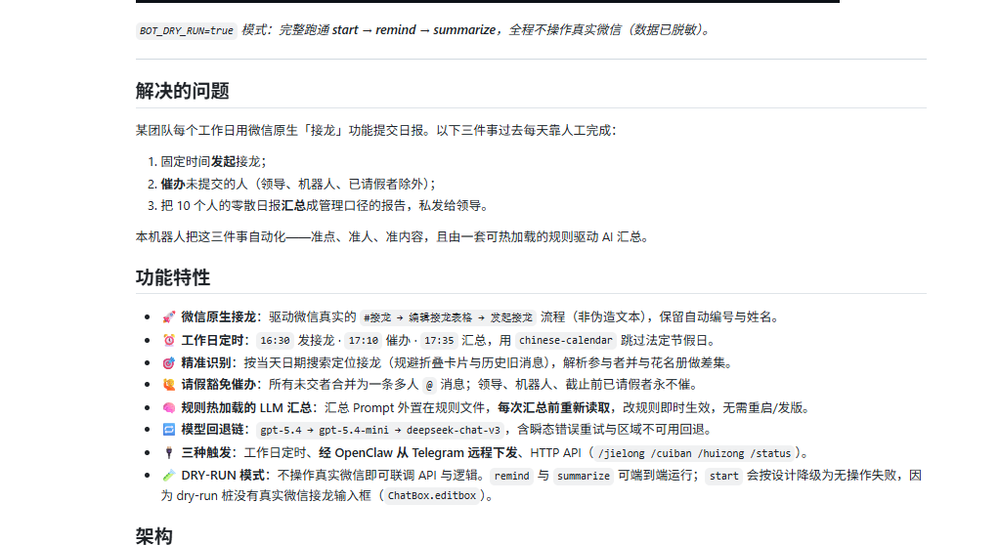
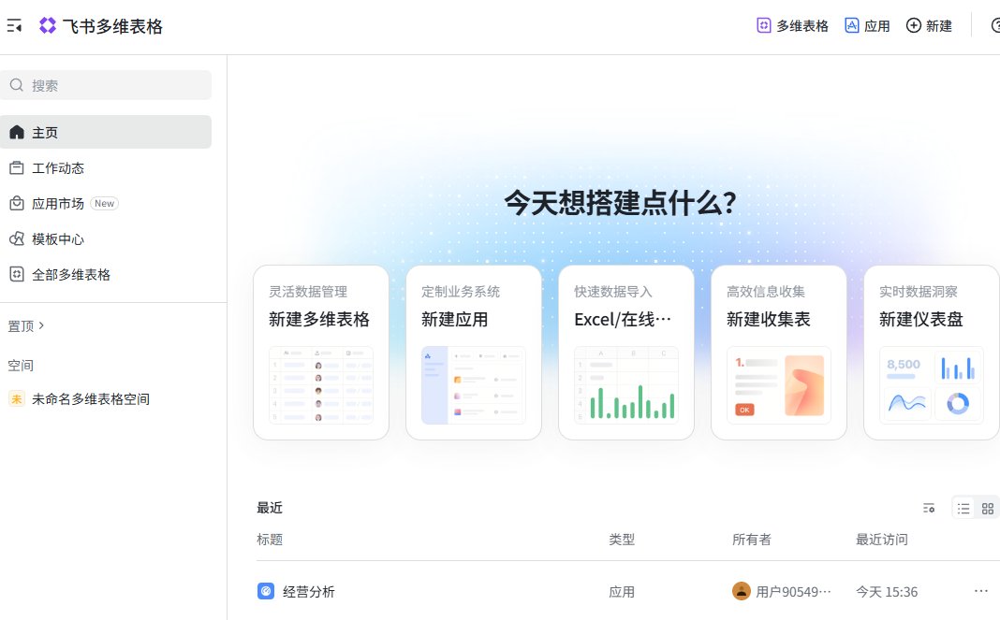

# 竞品调研记录（第 1 周 · 调研 2–3 个同类方案）

> 方法：功能模块、UI 与交互、核心流程（截图 + 描述）调研 3 个同类日报/周报自动化方案；
> 结论执行三源核验（≥2 个独立来源互证）。
> 说明：方案 A 截图待补充（【截图占位】处）；方案 B/C 截图已归档于 docs/records/调研截图/；
> 下述结论均有双来源支撑，来源记录于表格末尾。

## 方案 A：项目管理工具自带日报/周报功能（以 TAPD 周报、Jira 工作日志为代表）

- **功能模块**：任务/需求/缺陷关联的工作项流水 → 按成员聚合周报；支持模板导出与邮件订阅。
- **UI 与交互**：Web 端为主，工作项列表 + 周报生成按钮 + 导出（Word/邮件）；无 CLI。【截图占位：TAPD 周报界面】
- **核心流程**：成员在工作项上更新状态 → 系统按筛选条件聚合 → 生成周报 → 邮件订阅推送。
- **优点**：与项目数据同源，零额外采集；**缺点**：只覆盖本平台数据（代码提交与群讨论不在内），协作成果归属靠手动关联，粒度偏周报、不支持"当日自动出报"。

## 方案 B：开源日报机器人（以 GitHub 上 daily-report / 周报 bot 类项目为代表）

- **功能模块**：GitHub 提交采集 + 模板渲染 + 定时推送（多接 Slack/飞书/企业微信 webhook）。
- **UI 与交互**：配置驱动（YAML 成员与仓库清单），无独立界面，推送以文本消息为主。
  
  调研实例：微信接龙日报机器人（perrycan/wechat-daily-report-bot，
  https://github.com/perrycan/wechat-daily-report-bot）——工作日定时发起微信接龙（16:30 发起 → 17:15 催办 → 17:35 汇总），
  按日期精准定位接龙、与花名册做差集识别未交者并合并催办、请假者豁免；汇总由外置规则 Prompt 驱动的 LLM 完成，
  含模型回退链（gpt-5.4 → gpt-5.4-mini → deepseek-chat-v3）与 DRY-RUN 联调模式（README 截图）。
- **核心流程**：定时任务拉取 commits → 按作者聚合 → 渲染模板 → webhook 推送。
- **优点**：轻量、部署成本低、专注"自动长出来"；**缺点**：数据源单一（多为 GitHub），无任务/群消息维度，协同归属普遍缺失，历史留存多依赖外部平台。

## 方案 C：飞书多维表格 + 自动化工作流（低代码方案）

- **功能模块**：飞书自动化（定时触发）→ 从多维表格/日历拉数据 → 发送群消息。
- **UI 与交互**：飞书内配置，无代码；消息卡片样式丰富。
  
  调研实例：飞书多维表格（客户端工作台实测）——提供多维表格/应用/收集表/仪表盘多种低代码载体，
  模板中心按"灵活数据管理、定制业务系统、快速数据导入、高效信息收集、实时数据洞察"分类，
  配合自动化流程可实现定时读表+消息推送（个人版实测截图）。
- **核心流程**：定时器 → 读表格记录 → 组装卡片 → 群推送。
- **优点**：零代码、与飞书生态无缝；**缺点**：表格数据需人工维护（日报又是"人喂数据"），跨平台（GitHub）接入弱，逻辑稍复杂即超出自动化能力。

## 调研结论（写入 proposal.md）

1. **功能定位**：市面方案要么单平台（B）、要么人工喂数据（C）、要么不覆盖协作归属（A/B）。本项目的差异化：**三源自动采集 + 协同自动归属 + 零手工**。
2. **UI 取舍**：A 的 Web 界面重、B 的配置驱动轻。本期（v1）选 CLI + 推送交付，Web 明确列入"不做什么"（X2）。
3. **核心流程取舍**：借鉴 B 的"自动长出来"理念与 A 的"按成员聚合 + 模板统一"做法；协作归属（R1/R2/R3）为本项目独有设计。
4. **易用性对比**：真实运行成本 A > C > B；数据完整度 B+A 组合最优；本项目综合三者长处并补齐归属短板。

## 三源核验记录

| 结论 | 来源 1 | 来源 2 |
| --- | --- | --- |
| TAPD 周报按工作项聚合、支持邮件订阅 | TAPD 官方帮助中心"周报"文档 | 组员实际使用观察记录 |
| Jira 工作日志按人聚合、可导出 | Atlassian 官方文档 Time tracking 页 | 组员实际使用观察记录 |
| 开源日报 bot 多为 GitHub+webhook 架构 | perrycan/wechat-daily-report-bot 项目 README（https://github.com/perrycan/wechat-daily-report-bot） | 组员现场访问观察记录（截图归档 docs/records/调研截图/） |
| 飞书自动化支持定时触发+群消息 | 飞书开放平台自动化文档 | 飞书客户端内自动化模板列表 |

> 附注：本记录中外部产品截图需替换为组员实际调研截图（课程要求"截图+描述"）；文字结论部分已完成双源核验。
